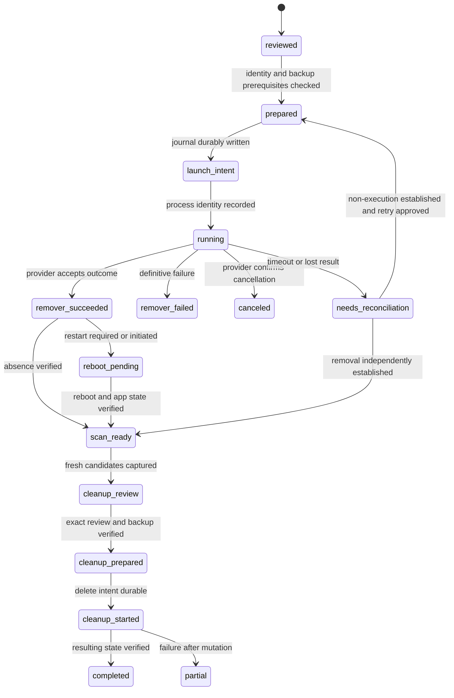

# Free uninstall and cleanup backend: research and implementation contract

Checked: **2026-09-14**. Repository baseline inspected: `33bbd55f1196657a5935c783db65a8a0c59448bb`, in the isolated `LeanClientOptimizer-optimizations` worktree. This is a baseline research report; implementation work proceeding alongside it must supply its own final diff and execution evidence.

The practical target is an independently implemented, free uninstall workflow: select several applications, review the exact removal operations, execute the official removers in a durable queue, inspect remaining app-specific data, and restore copied cleanup data when necessary. The first priority is reliable bulk execution and recovery. No Revo binary, license, proprietary removal engine, or proprietary trace database is required for that design.

This report distinguishes **documented vendor behavior**, **observed repository code**, and **proposed behavior**. It does not claim complete Revo parity or universal removal of every trace. No real application was uninstalled, no user data was deleted, and no registry, service, driver, or remote-machine changes were performed for this research. Frontend contents and the WinUI application were not accessed.

## 1. Revo feature matrix

Edition checks use the official [Free product comparison](https://www.revouninstaller.com/products/revo-uninstaller-free/) and [download comparison](https://www.revouninstaller.com/revo-uninstaller-free-download/). Their HTML matters: the download page marks unavailable features with `class="unavailable"`; the product comparison uses `checkmark-blue` versus `checkmark-gray`. Text extraction alone drops these distinctions and misleadingly lists paid features under Free.

| Capability | Official Free position | Official Pro position | Proposed free replacement |
| --- | --- | --- | --- |
| Official uninstall followed by leftover scan | Included | Included | Native provider adapters followed by a separately reviewable cleanup stage. |
| Windows app removal | Included | Included | Exact MSIX/Appx package and user scope; keep provisioning distinct. |
| Process/window target selection, called Hunter Mode | Included | Included | Later: resolve process image or shortcut to inventory identity; selection alone grants no deletion authority. |
| Eight companion cleaning tools | Included | Included | Reuse separate backend capabilities where suitable; do not couple them to app removal. |
| Forced removal of remnants | Unavailable | Included | Explicit orphan-remnant workflow with evidence and exclusions. |
| Quick/multiple uninstall | Unavailable | Included | Priority: reviewed sequential queue with per-entry status and recovery. |
| Extended leftover scan | Unavailable | Included | Additional evidence sources, not a promise that more matches are safe. |
| Installation monitoring and log database | Unavailable | Included | Later: locally captured installation evidence plus an original versioned recipe format. |
| Multiple backup layers | Unavailable | Included | Required cleanup backup, durable journal, optional verified restore point. |
| Browser extension removal | Official pages conflict | Included | Separate future browser/profile/extension-identity adapter. |
| USB distribution | Free Portable offered | Pro Portable offered | Portable backend possible; store journals/backups in a deliberately chosen writable location. |

The browser-extension discrepancy is unresolved: the download page includes it with Windows Apps in Free, but the Free product comparison marks it unavailable. Neither a Free binary nor an installed Free UI was inspected. Do not make an unqualified Free-edition claim from those conflicting pages. The portable offerings and paid-feature exclusions above are directly stated in the [download comparison](https://www.revouninstaller.com/revo-uninstaller-free-download/).

The [Pro uninstaller manual](https://www.revouninstaller.com/online-manual/uninstaller/) documents consecutive bulk removal, silent execution when available, scan modes, continuation after restart, and a final summary. It also documents forced removal, traced installation logs, history, Windows apps, and extensions. These are workflow references, not specifications for copying Revo's implementation. The manual acknowledges possible cross-product leftovers when products share folders, which supports retaining ownership review in the replacement.

| Additional workflow | Source | Replacement interpretation |
| --- | --- | --- |
| Installed-app search, grouping, export | [Uninstaller manual](https://www.revouninstaller.com/online-manual/uninstaller/) | Keep inventory identifiers stable independently of sorting, filtering, and labels. JSON/CSV export can be native. |
| Correcting an MSI repair route | [Uninstaller manual](https://www.revouninstaller.com/online-manual/uninstaller/) | Derive a typed MSI uninstall from verified product identity; never broadly rewrite arbitrary command text. |
| Partial/successful uninstall history | [Pro overview](https://www.revouninstaller.com/online-manual/) | Derive history from the operation journal, including failed and unresolved stages. |
| Trace import/export and editing | [Uninstaller manual](https://www.revouninstaller.com/online-manual/uninstaller/) | Treat imported recipes as untrusted suggestions; validate local identity, target state, and authorization again. |
| Scriptable removal/export | [Command-line manual](https://www.revouninstaller.com/online-manual/command-line-support/) | Expose native structured backend requests; no paid command-line dependency. |
| Selective backup restoration | [Backup Manager manual](https://www.revouninstaller.com/online-manual/backup-manager/) | Restore individually reviewed backed-up items with conflict detection. |

Revo's [Backup Manager manual](https://www.revouninstaller.com/online-manual/backup-manager/) says deleted registry entries are backed up automatically; file/folder backup is a separate option. This is not evidence that a completed vendor uninstall is reversible. The replacement should state the concrete recovery scope rather than use a broad “Undo uninstall” label.

## 2. Settings matrix

The Revo column below summarizes documented controls in the [Pro options manual](https://www.revouninstaller.com/online-manual/options/). The replacement column is an original proposed contract. The first release need not expose every setting: values that constrain safe execution should be enforced centrally.

| Setting family | Documented Revo controls | Proposed replacement behavior |
| --- | --- | --- |
| Scan depth | Safe, Moderate, Advanced | Name modes by their evidence sources and scope. Broader scanning adds candidates; it does not automatically strengthen ownership evidence. |
| Official-only removal | Built-in remover only | Supported first-class mode, including an empty cleanup manifest. |
| Backup location | Configurable folder | Bind resolved location into the operation; preflight writable space and exclusion from targets. |
| Restore point | Before uninstall | Record actual creation/result/identifier; show unavailable or failed explicitly. |
| Registry protection | Full backup; deleted-item backup | Keep registry mutation outside file cleanup. Add precise key/value exports only with a dedicated executor. |
| File deletion mode | Backup, Recycle Bin, permanent | Default to backed-up cleanup. Permanent purge is a separate reviewed operation. |
| Process handling | Forced stop | Default to identifying blockers; cancel remaining queue work without killing unrelated apps. |
| Candidate selection | Select leftovers automatically | Auto-selection limited to an explicit approved policy; new/changed data requires review. |
| Scan user scope | All-account option | Bind current user, named SID, or all users explicitly; never widen on privilege change. |
| System-item visibility | Updates/components | Visibility and permission remain separate. Seeing an item does not make it eligible. |
| Exclusions | Registry/folder lists | Add exact roots, subtrees, values, owner scopes, and reason codes. Exclusions win over cleanup recipes. |
| Cache rebuild | Re-read inventory | Rebuild derived inventory without resetting durable operation identity or authorizations. |
| Installation traces | Log location; retention | Local, versioned, exportable evidence; absence of a log is not proof of absence of leftovers. |
| Trace process scope | Include/exclude processes | Later: capture process tree and uncertainty explicitly. Concurrent activity is not automatically owned by the installer. |
| Recipe updates | Database updates | Original signed/versioned recipes, explicit provenance and local validation; no Revo database reuse. |
| Junk-file age | Recent-access exclusion | Treat age as a filtering hint; require approved roots and distinguish user content from disposable cache. |
| Junk patterns | Include/exclude patterns | Expand into an immutable exact candidate set before execution. A wildcard is not an execution allowlist. |
| Warnings | Suppression options | Routine informational messages may be hidden; a setting must not silently grant new destructive authority. |
| UI preferences | Language, themes, groups | Owned by the frontend workflow; no frontend implementation or inspection in this report. |

The three scan names are additionally documented in the [uninstaller manual](https://www.revouninstaller.com/online-manual/uninstaller/). The eight companion utilities are startup management, junk cleanup, Windows-tool shortcuts, browser history, Office history, Windows history, free-space erasure, and permanent deletion, listed by the [Free product page](https://www.revouninstaller.com/products/revo-uninstaller-free/). History clearing and irreversible erasure should remain separate explicit actions; they do not establish successful app removal. The [tools manual](https://www.revouninstaller.com/online-manual/tools/) provides their behavior, not a requirement to bundle them into a bulk uninstall.

## 3. Existing backend coverage and concrete gaps

The following observations describe the inspected baseline, not later work in this branch. “Present” means source exists; the research task did not execute the referenced regression scripts.

| Area | Existing coverage | Gap or implementation consequence |
| --- | --- | --- |
| Inventory | [Get-InstalledAppInventory.ps1](../../backend/scripts/Get-InstalledAppInventory.ps1) reads HKLM, the 32-bit HKLM path, HKCU, and current-user Appx; optional winget parsing. | Registry app IDs omit registry hive/view/owner. Appx `packageId` stores family name while removal preview uses it as the full-name operand. Inventory errors are mostly suppressed, so partial enumeration may look complete. |
| Classification | [UninstallCleanup.Common.ps1](../../backend/scripts/UninstallCleanup.Common.ps1), [protected-apps.json](../../backend/uninstall/protected-apps.json). | Catalog matches become manual-review requirements. Current `protected` and `blockByDefault` output are false; do not describe this as a dependency graph or hard protection. |
| Multi-app selection | [Preview-UninstallQueue.ps1](../../backend/scripts/Preview-UninstallQueue.ps1). | Preview only; no durable queue executor. The policy's batch limit is not enforced by this preview loop; duplicate requested IDs are not collapsed. |
| Official command preview | [Preview-OfficialUninstall.ps1](../../backend/scripts/Preview-OfficialUninstall.ps1). | Raw string splitting and substring MSI detection do not establish executable/product identity. Appx cmdlet text is not a native executable contract. |
| Process execution proof | [Invoke-OfficialUninstallCommandRunner.ps1](../../backend/scripts/Invoke-OfficialUninstallCommandRunner.ps1). | Harmless allowlisted shim route; this is not real-provider verification. Only zero exit is accepted and cancellation is checked before launch. |
| Leftover discovery | [Preview-LeftoverScan.ps1](../../backend/scripts/Preview-LeftoverScan.ps1), [leftover-scan-rules.json](../../backend/uninstall/leftover-scan-rules.json). | Metadata/known-rule candidates exist. Install location alone becomes high-confidence/default-selected; task/service name patterns are not exclusive ownership evidence. No actual post-uninstall rescan is performed by the real apply package. |
| Cleanup review manifest | [New-CleanupDeletionManifest.ps1](../../backend/scripts/New-CleanupDeletionManifest.ps1). | File/registry/service/task/startup backup requirements are described. A requirement is not an executed backup, and the preview's `rollbackSupported` field must not imply one exists. |
| Reviewed single-app apply | [Invoke-UninstallCleanupApplyPackage.ps1](../../backend/scripts/Invoke-UninstallCleanupApplyPackage.ps1). | A real-mode file/folder path exists with exact targets, approved app ID, input hashes, copy-before-delete, and vendor command first. An empty file/folder list needs no target allowlist, so a reviewed remover can run on its own when an app leaves nothing to clean; a non-empty list still requires every target on the exact allowlist. |
| Journal and retry | Same apply package; `Write-RooIndustriesCleanupJournal` in [common helpers](../../backend/scripts/UninstallCleanup.Common.ps1). | Flushed temporary file then replace/move; per-journal exclusive lock; intent persisted before official launch and deletion. An existing journal returns prior success/partial without continuing. This avoids automatic repeat but is not resume. Different journal paths can still describe the same app. |
| Reboot outcomes | Apply package's `officialRunnerCompleted` condition. | Accepts `exitCode -eq 0` only. MSI 3010/1641 need typed success/reboot outcomes. |
| Cleanup freshness | Apply package backs up before launching vendor remover, then deletes the approved paths. | Input hashes prove manifest-byte integrity, not unchanged target content. Vendor-created or other newly created data can appear at an approved path. A post-removal snapshot and new review are needed when content or ownership changes. |
| Restore | [Restore-UninstallCleanupExecution.ps1](../../backend/scripts/Restore-UninstallCleanupExecution.ps1). | File/folder copy restore exists for fixtures and explicit real mode. It copies backed-up entries, including entries that may not have been deleted, and overwrites file conflicts; no vendor reinstall or content-hash verification is established. |
| Filesystem safety | Common ancestor/descendant reparse checks; root/overlap checks in apply. | Useful defenses against static links. Check-then-copy/delete still leaves a race and is not equivalent to holding verified handles. Hard-link content/restore effects need their own treatment. |
| Capability routing | [cleanup-uninstall.json](../../backend/capabilities/cleanup-uninstall.json), [cleanup-uninstall.routes.json](../../backend/capabilities/routing/cleanup-uninstall.routes.json). | Queue apply is status-only, official apply is shim-only, cleanup/restore routing is fixture-only. These declarations are narrower than the separate real apply package. Final behavior and readiness claims must be reconciled. |
| Execution tests | `Test-UninstallCleanupBackend.ps1`, `Test-OfficialUninstallCommandRunner.ps1`, `Test-UninstallCleanupApplyPackage.ps1`, `Test-UninstallCleanupRestore.ps1`, runner/router tests. | Existing checks are starting assets. Their presence does not verify the new queue, restart cases, current Windows providers, or UI path. |

These are relevant baseline findings, not repairs performed by the research task. The implementation owner should resolve them within the authorized replacement work and obtain explicit approval for any separate pre-existing issue that falls outside that scope, under the repository's approval rule.

## 4. Native provider contracts

### 4.1 Identity must survive refreshes and privilege changes

An application display name is not a sufficient execution key. Proposed identity records:

| Provider | Identity bound into the review | Authoritative verification |
| --- | --- | --- |
| MSI | ProductCode, installation context, owner SID, reviewed version | `MsiEnumProductsExW` and `MsiGetProductInfoExW` in the same context. |
| Registered EXE | Hive, registry view, owner SID, full uninstall-key path, command bytes, executable path/hash, publisher/version evidence | Refresh that exact registration and inspect executable identity immediately before launch. Post-check uses a documented app adapter or conservatively reports uncertainty. |
| MSIX/Appx | PackageFullName, PackageFamilyName, user SID, architecture/version, package type | Package-manager enumeration for the same user/scope; family name is a grouping identity, not the removal operand. |
| Orphan leftovers | Captured prior app identity, exact roots/items, discovery evidence, scan time | Confirm no still-installed owner claims the resource. A missing registration alone is insufficient. |

Microsoft's [MSI enumeration API](https://learn.microsoft.com/en-us/windows/win32/api/msi/nf-msi-msienumproductsexw) distinguishes per-machine and per-user contexts, returns the owning SID, requires same-thread enumeration, and can require admin rights for other users. [MsiGetProductInfoExW](https://learn.microsoft.com/en-us/windows/win32/api/msi/nf-msi-msigetproductinfoexw) queries a specific product/context/SID. The native adapter should use that tuple for preflight and reconciliation.

Windows exposes separate [32-bit and 64-bit registry views](https://learn.microsoft.com/en-us/windows/win32/sysinfo/32-bit-and-64-bit-application-data-in-the-registry); use explicit view access and retain the view in inventory. Microsoft's [uninstall registry property reference](https://learn.microsoft.com/en-us/windows/win32/msi/uninstall-registry-key) documents MSI metadata, but those properties are not a complete resource-ownership map.

Do not replace inventory with `Win32_Product`: Microsoft documents that queries can trigger package consistency checks and repairs in [Windows Installer reconfigured all applications](https://learn.microsoft.com/en-us/troubleshoot/windows-server/admin-development/windows-installer-reconfigured-all-applications). Read-only discovery must remain read-only.

### 4.2 MSI commands and exit outcomes

For a validated product, construct a typed command such as `msiexec.exe /x {ProductCode} /norestart /L*V <operation-log>`, with UI mode chosen explicitly. `/x` removes a product; `/I` can install/configure it. `/quiet` without reboot suppression can restart without a prompt. `/norestart` corresponds to `REBOOT=ReallySuppress`; create the logging directory before launch. These are documented in [standard installer options](https://learn.microsoft.com/en-us/windows/win32/msi/standard-installer-command-line-options) and [msiexec](https://learn.microsoft.com/en-us/windows-server/administration/windows-commands/msiexec).

The exact code meanings below come from [Microsoft's installer error-code table](https://learn.microsoft.com/en-us/windows/win32/msi/error-codes). Queue actions are proposed policy, not additional Microsoft guarantees.

| Code | MSI meaning | Proposed queue interpretation |
| --- | --- | --- |
| `0` | Success | Record remover success, then independently verify app state before cleanup. |
| `3010` | Success; restart required | Persist successful remover outcome plus `rebootRequired`; defer cleanup/reconciliation as appropriate. Never rerun simply because the app still appears before reboot. |
| `1641` | Success; restart initiated | Flush result if possible and stop new queue launches. Resume through post-reboot reconciliation. |
| `1602` | User canceled | Canceled entry; no leftover deletion and no automatic retry. |
| `1618` | Another installation running | Retryable contention with bounded backoff, cancellation checks, and a fresh identity check before another launch. |
| `1605` | Unknown/not-installed product for action | Reconcile the exact context; do not turn a wrong SID/product into silent success. |
| `1614` | Product uninstalled | Reconcile actual absence and retain an already-absent outcome. |
| `1603` | Fatal failure | Preserve logs and partial state. No automatic cleanup. |
| `1612`, `1619`, `1620` | Source/package unavailable or invalid | Record the exact provider requirement; no guessed replacement command. |

These meanings apply to Windows Installer. A random vendor EXE returning 3010 is not automatically an MSI success unless its documented adapter adopts that convention. Keep raw exit code, normalized outcome, provider, and diagnostic evidence separate.

### 4.3 Registered EXE removers

Treat registration metadata as a reviewed command proposal. Preserve quoting and argument boundaries; use a resolved executable with `UseShellExecute=false` rather than dispatch through `cmd /c`, `Invoke-Expression`, or a string-evaluating shell. Reject malformed commands and unknown executable resolution. Do not infer silent flags from installer branding, and do not globally substitute `/I` with `/X` in arbitrary text.

A published quiet command may be offered as a separate reviewed route. UI-capable removers need a documented execution mode; hiding their parent process does not prove that a child dialog cannot appear. The first release can implement silent MSI and specifically reviewed EXE adapters while returning an exact interactive-provider requirement for unsupported vendors. This is a provider capability distinction, not a claim that all uninstall is blocked.

Bind executable hash/signature information, arguments, working directory, user context, timeout policy, and reboot policy into the approved operation. Hashing only the JSON still permits a different binary at the same path; record and revalidate the binary too.

### 4.4 MSIX/Appx removal and dependencies

[`Remove-AppxPackage`](https://learn.microsoft.com/en-us/powershell/module/appx/remove-appxpackage?view=windowsserver2025-ps) removes an exact package full name or package object. Default scope is the current user; other-user and all-user operations are separate privileged choices. `-PreserveApplicationData` is restricted to development apps registered from loose files, so it cannot justify a general “keep all app data” promise. The adapter must capture terminating errors and deployment diagnostics, not infer success merely from a PowerShell host exiting.

[`Remove-AppxProvisionedPackage`](https://learn.microsoft.com/en-us/powershell/module/dism/remove-appxprovisionedpackage?view=windowsserver2025-ps) addresses Windows-image provisioning for future accounts. Keep that operation separate from removal of existing user registrations. The reviewed scope must not silently expand to provisioning removal.

Microsoft identifies `NonRemovable` as relevant to system-package removal in its [Store app troubleshooting guidance](https://learn.microsoft.com/en-us/troubleshoot/windows-client/shell-experience/modern-inbox-store-apps-troubleshooting-guidance). Obtain framework/resource/optional/bundle and dependency facts where supported. [Package.Dependencies](https://learn.microsoft.com/en-us/uwp/api/windows.applicationmodel.package.dependencies?view=winrt-26100) exposes forward dependencies; invert verified relations to identify dependents that would remain. Its documentation directs an unpackaged process to package-information APIs instead of `Package.Current`. Unknown dependency coverage must remain unknown.

## 5. Reviewed bulk queue and durable recovery

### 5.1 Immutable inputs

Proposed queue preparation returns one stable operation ID and a digest of canonical immutable data. Each entry has its own stable ID and app identity; queue order, provider command, approval scope, policy/recipe version, and cleanup policy are part of the digest. Duplicate app identities or duplicate entry IDs are rejected or explicitly collapsed before review. The queue maximum is validated before any side effect.

Load the reviewed bytes once, verify their digest, deserialize that snapshot, and execute from it. Child runners should consume the captured data or an immutable verified copy; repeatedly reopening mutable source paths would undermine review. Revalidate live app and executable identity before every new launch. A fresh app version, changed command, changed owner, added target, or changed cleanup data invalidates the affected approval.

The journal is mutable execution state and must not be confused with the immutable plan. Store journals and backups outside the repository, under an operation-specific directory whose ACL and owner match the execution boundary. Repository `backend/state` remains empty after validation.

### 5.2 State machine

This is a design target; a simpler implementation may use fewer names while preserving these distinctions. Queue status is an aggregate of per-entry state. “Partial” must preserve which app and which stage changed. Never collapse mixed success/failure into a global success.

Recommended journal fields:

- `operationId`, `schemaVersion`, immutable plan hash, machine binding, owner SID, provider versions, and ordered entry identities.
- Entry `state`, attempt IDs, raw and normalized outcome, start/end times, PID plus process creation time, reboot requirement, and reconciliation evidence.
- Before every consequential action: intended command or exact target, preconditions, verified backup manifest, and attempt ID.
- After action: observed result, provider exit/HRESULT/Win32 code, logs, actual target existence/content result, and unresolved scope.
- Restore records, retained backup hashes, conflict decisions, and whether a previous restore has already completed.

Reuse the existing flushed-temp-file journal primitive, but add schema and operation validation, monotonic state transitions, and cross-entry serialization. Do not claim sudden-power-loss durability solely because a normal write succeeded; exercise journal recovery after injected interruption. A complete previous journal plus deterministic recovery rules is preferable to treating a truncated file as a fresh run.

### 5.3 Concurrency, cancellation, partial failure, and retry

Run official removers sequentially initially. Use a lock keyed by machine/owner/app identity as well as the operation journal; separate operation directories must not permit simultaneous removal of the same app. Scope MSI contention independently because another installer may run outside this queue. Queue cancellation is cooperative: stop scheduling new entries and check the signal at phase boundaries.

Cancellation during a generic remover cannot promise transactional rollback. Do not automatically kill the remover or its descendants merely because the user cancels remaining queue work. If a provider supports cancellation, record its actual result. If the process must be terminated under an explicitly reviewed timeout policy, classify the outcome as needing reconciliation and retain recovery data.

Microsoft documents that [`Process.Kill`](https://learn.microsoft.com/en-us/dotnet/api/system.diagnostics.process.kill?view=net-9.0) is asynchronous and abnormal termination can lose data. Parent `WaitForExit`/`HasExited` does not establish that descendants exited, even after a tree-kill request. This matters because the current shared runner kills on timeout and later consumes redirected output. Provider launchers that hand work to another process require provider-specific completion evidence and bounded output handling.

Retry rules should be explicit:

1. Never-started entries can resume after a fresh preflight against the same approved identity.
2. Definitively successful removers are not relaunched; resume at verification, reboot reconciliation, or cleanup review.
3. Definite pre-launch failures can retry after the exact requirement is fixed and identity remains unchanged.
4. MSI busy contention can retry within a bounded budget; a new result gets a new attempt record.
5. Timeout, crash, lost exit result, or launch-intent-only state requires reconciliation. A PID disappearing is not proof of uninstall completion or non-execution.
6. Already-absent is distinct from successful removal by this operation. Confirm provider identity and context before using it.
7. Cleanup retry only addresses recorded incomplete items. A new or changed item at the same pathname is not covered by the old attempt.

A file journal cannot make arbitrary third-party removers exactly-once across the crash window between process start and durable result capture. The achievable contract is durable intent, no blind repeat of attempted work, provider-specific reconciliation, and safe continuation of untouched work. State that limit explicitly.

Reboot policy should default to deferral. Persist accepted remover success before any restart. On 1641, stop scheduling immediately; on 3010, record the pending reboot and conservatively postpone cleanup for that entry. After restart, compare a boot marker and re-query app state before proceeding. Automatic reboot itself needs separate user authorization.

## 6. Leftover evidence and dependency safeguards

The native scanner should return evidence-bearing candidates, not a list of strings presented as ownership facts.

| Evidence | Suitable use | Insufficient inference |
| --- | --- | --- |
| Exact installer/package resource mapping | Strong candidate identity, subject to shared ownership and current state | Every resource in the parent directory is removable. |
| Versioned app recipe matching product/publisher/version | Discover exact known paths and expected value shapes | A publisher match owns all publisher folders. |
| Reviewed install location | Discover a candidate root | This root contains only this app or only disposable data. |
| Service/task/startup executable reference | Relate a specific item to a verified executable | A name containing an app word makes deletion safe. |
| Before/after install trace | Attribute observed changes with recorded confidence | Every change during the time interval was made by the installer. |
| Before/after uninstall scan | Identify remaining or changed resources | The vendor's zero exit means remaining resources are safe junk. |
| Fuzzy name or folder match | Manual review suggestion only | High-confidence automatic deletion. |

For every candidate record: preserve the evidence source and exact match, owner identities, path/key/value kind, raw and resolved target, content or subtree snapshot, existence/error state, timestamp, policy version, and risk reason. A field named `matchedBy: publisher` should exist only when a publisher was actually compared. Distinguish “not found,” “access denied,” “provider unavailable,” and “enumeration incomplete.”

Scan after the official remover finishes and absence is verified. Existing pre-reviewed candidates may be retained only if current identity, contents, and ownership match the reviewed snapshot. New candidates are a fresh review set. Never broaden a approved file list to the entire folder or re-expand wildcards during deletion.

Dependencies need concrete handling:

- Preserve shared runtimes, frameworks, redistributables, Windows components, security/network access components, and driver packages by default in bulk cleanup. Surface exact facts and review requirements.
- Detect overlapping install roots, shared executable references, common publisher directories, and package dependencies across both queued and retained apps.
- If both parent and dependent are selected, use verified dependency ordering; if the dependent remains, block that dependent resource's cleanup. Do not invent dependency edges from names.
- Treat game libraries, saves, documents, browser profiles, account/session databases, and cloud-synced folders as user content unless separately approved. Removing a launcher does not imply removing its games.
- Keep registration cleanup, service removal, scheduled tasks, startup entries, provisioning, and drivers behind separate typed executors with dedicated export/restore semantics.

Microsoft's [MSI component rules](https://learn.microsoft.com/en-us/windows/win32/msi/organizing-applications-into-components) explicitly allow components to be shared across applications and versions. That is why raw filesystem deletion should not replace the official installer operation, and why a surviving shared resource is not automatically a leftover to purge. A dedicated forced-remnant mode should operate only on evidence-backed orphan data and disclose that it does not remove unknown installer registrations or repair arbitrary broken installs.

## 7. Filesystem safety and restoration

### 7.1 Static path checks and native handle checks

The existing root, overlap, and reparse checks should remain. Resolve environment values from the reviewed user context, reject root targets, reject target/backup overlap in either direction, and reject ancestor/descendant duplicate targets. Keep backups and journals out of deletion trees. Do not equate a string prefix with filesystem identity.

Windows [reparse points](https://learn.microsoft.com/en-us/windows/win32/fileio/reparse-points) include links and mounted folders. Microsoft documents that ordinary copy operations can follow source or destination symbolic links, while opening with `FILE_FLAG_OPEN_REPARSE_POINT` affects which object a handle references in [symbolic-link effects](https://learn.microsoft.com/en-us/windows/win32/fileio/symbolic-link-effects-on-file-systems-functions). Merely checking an attribute and then invoking a pathname operation leaves a change window.

For stronger real-system cleanup, use a small native helper or equivalent P/Invoke adapter that holds verified handles during backup and mutation. Required capabilities:

1. Open each source and destination parent with appropriate access and reparse handling; validate ancestors and final resolution. Refuse unsupported storage semantics instead of claiming they are safe.
2. Retrieve final path with [`GetFinalPathNameByHandleW`](https://learn.microsoft.com/en-us/windows/win32/api/fileapi/nf-fileapi-getfinalpathnamebyhandlew), and file metadata/identity with [`GetFileInformationByHandleEx`](https://learn.microsoft.com/en-us/windows/win32/api/winbase/nf-winbase-getfileinformationbyhandleex). Verify the object remains inside the reviewed scope.
3. Bind backup bytes and deletion to the same verified object. Where appropriate, use handle-based rename/disposition through [`SetFileInformationByHandle`](https://learn.microsoft.com/en-us/windows/win32/api/fileapi/nf-fileapi-setfileinformationbyhandle); deletion requires suitable access. A directory tree still needs individually validated traversal.
4. Return raw platform errors, file IDs, resolved paths, byte counts, backup hashes, and whether mutation occurred. The report proposes this helper contract; it does not claim such a helper was built or tested here.

[Hard links](https://learn.microsoft.com/en-us/windows/win32/fileio/hard-links-and-junctions) share a file object, and modifications through one link affect the others. Deleting a name and overwriting content during restore have different consequences. Do not treat absence of a reparse attribute as proof that a file has no aliases. Exercise hard links, junctions, symbolic links, changed ancestors, mount points, and destination links on Windows before broadening real-system claims.

### 7.2 Backup and restore are bounded promises

For proposed file cleanup, verify that each completed backup is readable and matches the approved file/subtree inventory before deleting. Include content hashes and distinguish file contents from metadata coverage. If ACLs, alternate streams, encryption, sparse allocation, timestamps, or links are not preserved, expose that precise limit. A path existing under the backup root is not sufficient backup integrity evidence.

Restore should default to missing targets only. If a target exists and differs, stop that item and report a conflict; allow a separately reviewed replace or alternate-location restore. Save a destination backup before any approved overwrite. Handle uncertain prior deletion through actual target/backup comparison, not only a `deleted` boolean that might not have been written before a crash.

Keep separate capability/result fields for:

- `fileContentRestore`: exact copied data that can be restored and verified.
- `registryRestore`: only items exported with sufficient type/value/security coverage by a dedicated executor.
- `vendorUninstallReversible`: false or unknown unless an app-specific reinstall/repair path is actually verified.
- `systemRestorePoint`: requested, created, reused, unavailable, or failed, with actual identifier/result.

[`Checkpoint-Computer`](https://learn.microsoft.com/en-us/powershell/module/microsoft.powershell.management/checkpoint-computer?view=powershell-5.1) is a Windows-client restore-point cmdlet and is limited to one checkpoint per day. Do not promise a new point for every app in a batch or treat a request as confirmed recovery. Confirm availability and actual evidence; the lack of a restore point does not erase the distinction between controlled copied-file recovery and irreversible vendor removal.

[Restart Manager](https://learn.microsoft.com/en-us/windows/win32/rstmgr/about-restart-manager) can identify/use coordinated application shutdown to reduce reboots, subject to permissions and session limits. A future adapter can expose blockers and supported shutdown behavior. It should not silently turn cleanup into service/process termination.

## 8. Implementation order and readiness requirements

| Priority | Deliverable | Observable acceptance condition |
| --- | --- | --- |
| P0 | Native reviewed bulk queue | Multiple distinct apps execute sequentially from immutable inputs; official-only and no-leftover cases complete; duplicates and conflicting identities are rejected before side effects. |
| P0 | Durable per-app state and recovery | Cancel/resume works for never-started entries; partial success survives process restart; attempted unknown entries never launch again without reconciliation. |
| P0 | Typed official outcomes | MSI 0/3010/1641/1602/1618 and errors produce correct states; arbitrary EXE codes use their own adapter contract. |
| P0 | App identity fixes | Registry scope/view/owner and Appx full/family names cannot be confused; a refreshed but changed command/app invalidates review. |
| P0 | Fresh cleanup boundary | Remover failure, timeout, pending reboot, incomplete detection, or changed/new data cannot lead directly to deletion. |
| P0 | Truthful recovery/result reporting | File recovery, vendor removal, reboot, unresolved failure, and actual deleted count are reported separately. |
| P1 | Strong leftover evidence | Shared roots, retained dependents, fuzzy matches, and user data are excluded; only evidence-backed reviewed items reach the executor. |
| P1 | Native filesystem guard | Controlled fixtures prove link/race/alias handling, verified copy/delete, restore conflict behavior, and exact platform errors. |
| P1 | Registry/task/startup cleanup | Read-only detection first; typed export, exact mutation, restore, and negative tests before enabling each family. |
| P2 | Original installation tracing/recipes | Recipe format, provenance, versioning, local ownership checks, import validation, and storage limits exist independently of Revo assets. |
| P2 | Extension/process selection and companion tools | Separate scoped capabilities with their own user-data and restore contracts; not prerequisites for the core bulk queue. |

No universal “requires elevation” blocker should substitute for investigation. For an actual Windows failure, capture command/API, process token/admin status, helper manifest, architecture, executable/tool availability, ACL/security product evidence, Win32/HRESULT/exit code, stdout/stderr, and the next engineering action. This follows the repository's execution-readiness rule. This report did not probe Windows tokens or infer the target machine's current privilege state.

## 9. Verification matrix

All cases below are **required/proposed execution evidence**, not tests run by this report. Preserve applicable regressions in the backend's normal verification commands. Use disposable files and harmless typed process fixtures through the same queue and runner paths before any approved provider integration run.

| Concern | Discriminating check | Expected result and evidence |
| --- | --- | --- |
| Bulk success | Two different shim-backed apps plus empty cleanup | Both invoked once in order; journal records each phase; no leftover requirement invents work. |
| Duplicate selection | Repeated entry ID and same app under two IDs | Reject or deterministically collapse during preparation; invocation counters remain zero before valid review. |
| Immutable review | Change one command byte, target, owner, or queue order after review | Digest mismatch prevents process start and backup/deletion. |
| Binary replacement | Replace executable content at same path | Revalidation rejects changed binary even when manifest hash matches. |
| MSI repair route | Fixture metadata publishes `/I` | Typed adapter constructs reviewed `/x` only from independently validated ProductCode/context. |
| Exit-code contracts | Provider fixtures return 0, 3010, 1641, 1602, 1618, 1603 | Exact normalized states; no cleanup for failure/cancel/unknown; reboot state preserved. Use Windows processes to verify full Windows exit codes. |
| Busy retry | First MSI attempt 1618, next success | Bounded retry count, separate attempts, cancellation honored; no retry after accepted success. |
| Pre-launch cancel | Cancellation signal before entry start | Entry/process remains untouched; queue can later resume with current identity. |
| Mid-queue cancel | First entry completes, then signal | Completed entry remains completed; later entries remain unlaunched. |
| Mid-remover cancel | Long-running provider receives queue cancellation | No false rollback claim; no next entry launched; provider-specific completion or reconciliation recorded. |
| Unknown result | Terminate host after launch intent or after process start | Resume does not launch attempted entry again blindly; evidence identifies unresolved result. |
| Result-write failure | Fail journal update after provider success | Existing durable intent prevents blind repeat; reconciliation resolves the entry. |
| Journal corruption | Truncate latest file; supply mismatched operation metadata | Recover valid prior state or report corruption; never interpret as a new operation. |
| Concurrent operations | Two processes target same app through different operation directories | Exactly one owns execution; second fails/waits without duplicate remover launch. |
| Mixed queue outcomes | Success, definite failure, never-started entry | Aggregate partial status and precise per-entry facts; continue only per reviewed failure policy. |
| Restart/resume | Save 3010/1641 then simulate new process/boot marker | No duplicate uninstall; post-boot app verification determines the next phase. |
| Appx scope | Same family, two full names/users | Only the exact reviewed full name and SID is addressed; no all-user/provisioning expansion. |
| Partial inventory | Denied registry view/package enumeration | Unknown/incomplete detection recorded; absence not inferred from empty output. |
| Shared dependency | Retained app references selected app's candidate resource | Candidate excluded or needs explicit dedicated review; no deletion. |
| Changed leftovers | Vendor fixture writes new data at reviewed path | New/changed content is held for fresh review; old digest never authorizes broader deletion. |
| Backup failure | Read error, disk limit, hash mismatch | No deletion of that target; backup status and exact failure recorded. |
| Filesystem aliases | Junction/symlink/ancestor swap/hard-link fixtures | Out-of-scope sentinel bytes and metadata stay unchanged. A static link test alone does not prove race resistance. |
| Partial deletion | First file removed, second denied | Journal retains first deletion and both backups; partial recovery can restore correctly. |
| Restore conflict | Modify/recreate target after cleanup | Default restore reports conflict without overwrite; alternate/replace requires exact reviewed policy. |
| Corrupt backup | Alter backup bytes but preserve filename | Hash failure blocks restore and retains evidence. |
| Restore retry | Repeat completed restore | No silent overwrite of subsequently changed user data; result distinguishes already restored. |
| Truthful counts | Vendor removed item before cleanup; target already absent | No invented deleted-byte/count savings; report already absent separately. |
| Repository hygiene | Before/after state/process/temp inspection | `backend/state` empty; no operation fixture, helper, temp utility process, or unrelated change remains. |

For critical acceptance checks, demonstrate a representative wrong implementation fails: for example, temporarily accept only MSI zero and show the 3010 regression fails, or remove review-digest validation and show a changed-input test detects the unexpected invocation. Restore controlled mutations afterward. A fixture reporting “blocked” does not prove executor readiness.

## 10. Evidence and verification limits

**Verified by this research:** official source text and comparison HTML; source-level baseline backend paths and conditions; the known distinctions among MSI product identity, Appx full/family name, provisioning, documented reboot codes, file-link behavior, and restore-point limits. Web sources were checked on 2026-09-14. Older documentation publication dates are not treated as newer runtime test evidence.

**Not executed here:** Windows MSI/Appx APIs, any vendor uninstall, reboot handling on a live target, native filesystem helper behavior, restore-point creation, actual cleanup/restore, browser-extension removal, Revo UI/binary behavior, queue tests, or frontend routing. A shim passing on Linux does not establish Windows MSI/Appx behavior. The proposed verification matrix must be reconciled with the implementation owner's actual results.

**Source discrepancy:** Free browser-extension availability is inconsistent across official pages. The Free guide PDF linked from the [support page](https://www.revouninstaller.com/support/) could not be retrieved through the available web reader; no claims are based on its unread content. The online Pro manual was accessible and supplies the workflow/settings reference. No third-party comparison article is used as authority.

**Completion boundary:** shipping a usable free core queue is achievable without proprietary assets. Complete Revo-equivalent scanning, installation tracing, browser data handling, arbitrary broken-installer recovery, registry/service/driver mutation, and universal reinstall rollback are separate implementation and verification work. Keep their readiness explicit rather than claiming parity from the existence of previews or fixture-only routes.
